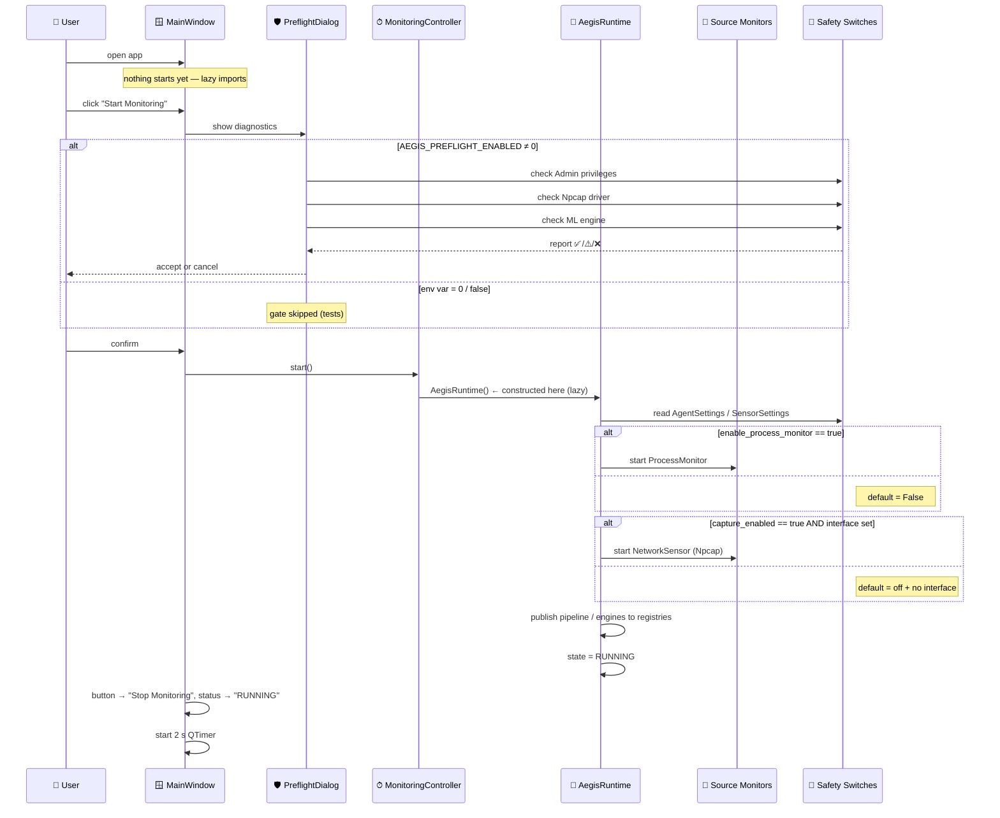
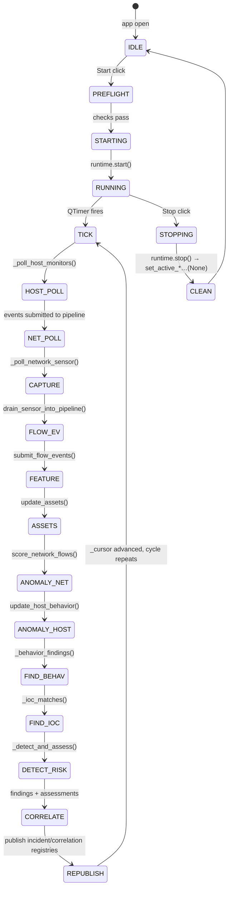
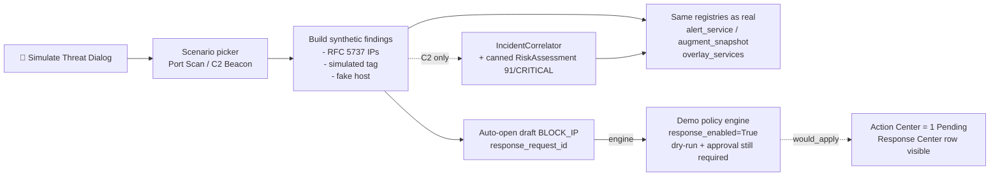
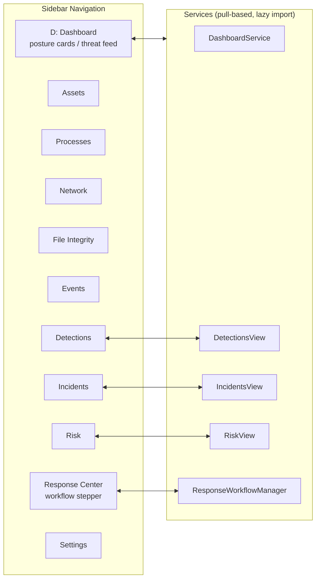
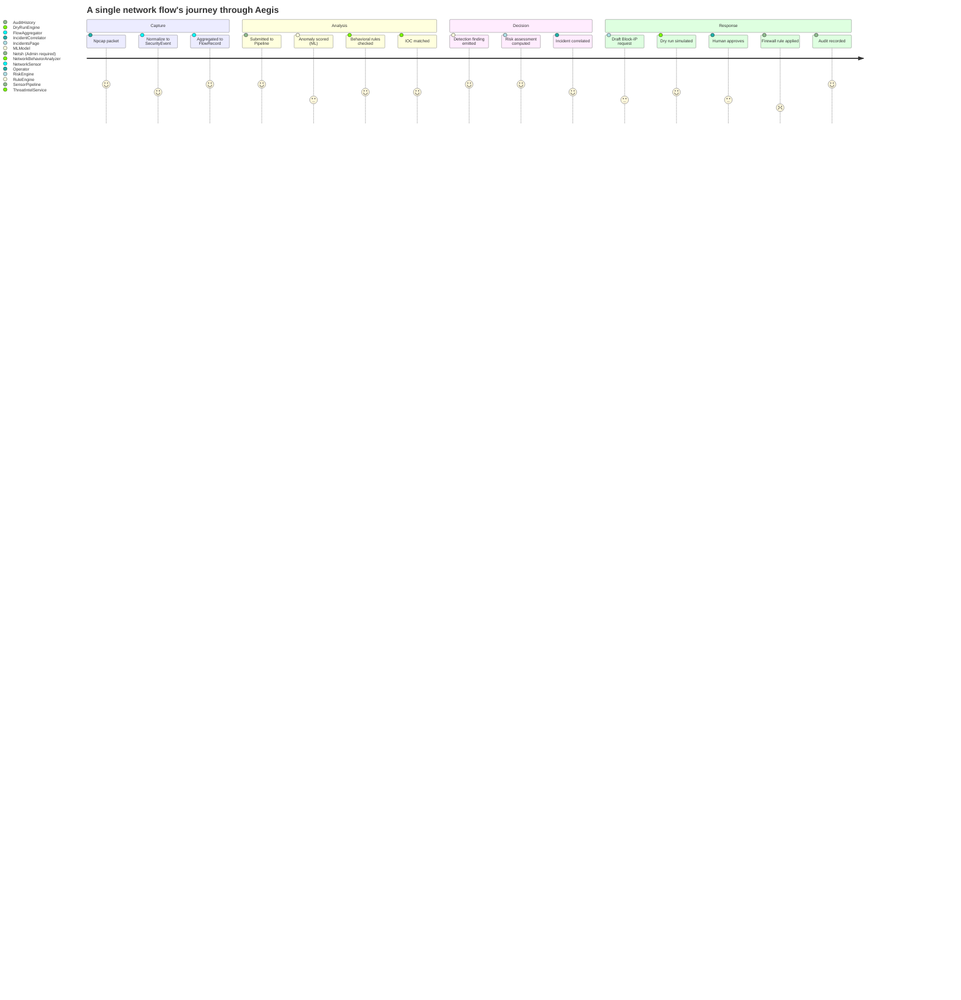
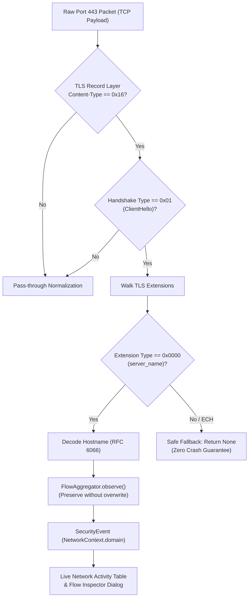
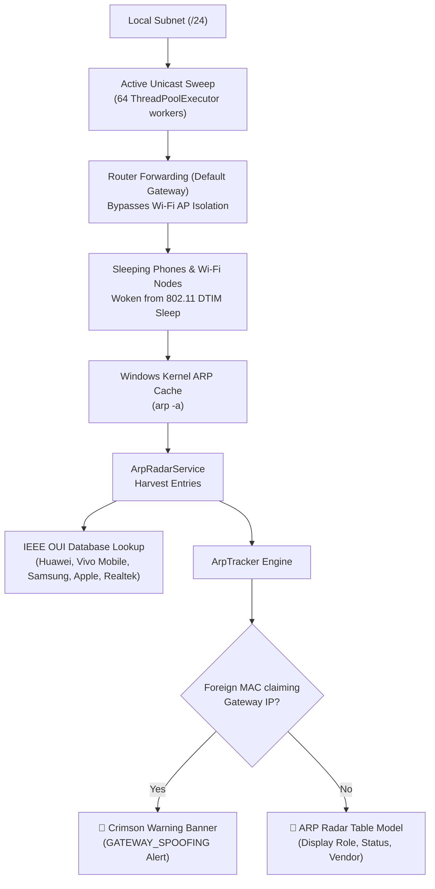

# Aegis IDPS — Visual Flow Diagrams

> Readable as plain text AND as Mermaid diagrams (rendered by GitHub / GitLab / VS Code + Mermaid extension).  
> See [`working_flow.md`](./working_flow.md) for the full step-by-step prose.

---

## 1. System Topology

```mermaid
graph TB
    subgraph Desktop["🖥  Aegis Desktop Console"]
        W[MainWindow] -->|QTimer 2 s| Ctrl[MonitoringController]
        Ctrl -->|poll_once| RT[AegisRuntime]
        W -->|start| PF[PreflightDialog]
        W -->|Simulate Threat| DS[Threat Simulation]
        W --> Nav[Navigation: 11 Pages]
    end

    subgraph Runtime["⚙ Aegis Runtime"]
        RT --> D[Detection Engine]
        RT --> R[Risk Engine]
        RT --> C[Correlators]
        RT --> Ioc[IOC Matcher]
        RT --> B[Behavioral Analyzer]
    end

    subgraph Sources["📡 Telemetry Sources"]
        AG[Agent Monitors\nprocess / port / file / YARA]
        NS[Network Sensor\nNpcap + Scapy + FlowAgg]
        DL["Disabled by default\n(opt-in via .env)"]
        AG & NS --> PE[RuntimeEventPipeline]
    end

    subgraph Response["🔒 Response Engine"]
        RE[ResponsePolicyEngine]
        DR[ResponseDryRunEngine]
        EX[ResponseExecutor]
        FW[WindowsFirewallAdapter\nnetsh advfirewall]
        AUD[AuditHistory]
    end

    subgraph Shared["🧩 aegis_shared Contracts"]
        EVT[SecurityEvent schema]
        ENUM[EventCategory / EventType / Severity]
        REG[Active Registries\npipeline / engine / risk / incidents]
    end

    PE --> D & R
    D --> EVT
    R --> EVT
    C --> REG
    RT --> REG
    DS -.->|fake data| D & C
    Nav --- RegPull[collect_*_view() services]
    RegPull --> NAV
    RT -- approved request --> EX
    EX -- netsh rule --> FW
    FW --> AUD
```

---

## 2. Start Monitoring — Sequence



---

## 3. The Poll Loop (every 2 seconds)



**One tick output (summary):**

| Metric | Source |
|---|---|
| Host events collected | `_poll_host_monitors()` |
| Network events collected | `_poll_network_sensor()` |
| Findings emitted | `_cycle_findings` |
| Risk assessments emitted | `_cycle_assessments` |
| Errors isolated (never abort) | `_record("...", exc, errors)` |

---

## 4. Event → Finding → Incident → Response

```mermaid
flowchart TD
    subgraph S1["① Ingest"]
        EVT[SecurityEvent]
    end

    subgraph S2["② Detection"]
        DET[Evaluation Engine\nAEGIS-NET-xxx / AEGIS-EXEC-xxx rules]
        BEH[Behavioral Analyzer\nnetwork flow patterns]
        IOC[IOC Matcher\nlocal threat intel]
    end

    subgraph S3["③ Risk"]
        RISK[RiskEngine.assess_many()\n+ ML anomaly signals]
        RA[RiskAssessment\nscore 0-100 / level]
    end

    subgraph S4["④ Correlation"]
        INC[IncidentCorrelator\n→ OPEN incident]
        HNC[HostNetworkCorrelator\n→ evidence bond]
    end

    subgraph S5["⑤ Response"]
        REQ[draft Request\nBLOCK_IP target]
        DR[Dry Run\nResponseDryRunEngine\nwould_apply?]
        APP[Approval\nhuman operator]
        EXE[Execute\nResponseExecutor + WindowsFW]
        AUD[Audit record\nResponseAuditHistory]
        VER[Verify\nis_blocked re-check]
    end

    EVT --> DET & BEH & IOC
    DET & BEH & IOC --> FINDING[DetectionFinding []]
    FINDING --> RISK
    RISK --> RA
    FINDING --> INC
    RA --> INC
    FINDING --> HNC

    INC -. initiate response .-> REQ
    REQ --> DR
    DR -- would_apply --> APP
    APP -- approve --> EXE
    EXE -- netsh add rule --> FW[(Windows Firewall)]
    FW --> VER
    VER --> AUD
```

**Guards before Execute (`executor.py`):**

| Guard | Reject if |
|---|---|
| Action | not `BLOCK_IP` |
| Workflow | not `approved` |
| Policy decision | `denied` |
| Dry-run result | not `would_apply` |
| Target kind | not valid IP |

---

## 5. Demo / Simulation Parallel Path



**Key guarantees:**

- ❌ No packet capture, no malware, no network change
- ✅ Same UI pages, same widgets, same tests
- 🔁 Re-running creates new rows (request ids are unique)
- 🧹 `clear_simulated()` + `mgr.clear()` resets everything

---

## 6. Safety Stack (Fail-Closed Design)

```mermaid
graph BT
    SW[🔒 Safety Switches]

    NETCAP["capture_enabled=false\n+ explicit interface required"]
    MONS["enable_process/ Port / connection /\nfile_integrity / yara = false"]
    FI_PATHS["file_integrity_paths = empty"]
    RESP_OFF["response_enabled=false\napproval_required=true\ndry_run_required=true\nautomatic_execution=false"]
    PREFLIGHT["AEGIS_PREFLIGHT_ENABLED\ngate admin & driver checks"]

    SW --> NETCAP
    SW --> MONS
    SW --> FI_PATHS
    SW --> RESP_OFF
    SW --> PREFLIGHT

    NOTE1["Enabling any switch requires\nsetting AEGIS_* env vars"]
    NOTE2["Response execution ONLY after\n: Dry Run → Approve → human press Execute"]

    NOTE1 & NOTE2 -. show.-> SAFETY_MSG[⚠ "Nothing invasive happens\nunless explicitly enabled"]
```

**Defaults at a glance:**

| Env var | Default | Effect when set |
|---|---|---|
| `AEGIS_SENSOR_CAPTURE_ENABLED` | `false` | Packet capture on selected interface |
| `AEGIS_SENSOR_INTERFACE` | *(empty)* | Interface name (required when capture on) |
| `AEGIS_AGENT_ENABLE_PROCESS_MONITOR` | `false` | Track process start/stop |
| `AEGIS_AGENT_ENABLE_PORT_MONITOR` | `false` | Track listening ports |
| `AEGIS_AGENT_FILE_INTEGRITY` | `false` | Hash monitored files |
| `AEGIS_AGENT_FILE_INTEGRITY_PATHS` | *(empty)* | Paths to watch |
| `AEGIS_RESPONSE_POLICY_RESPONSE_ENABLED` | `false` | Allow firewall rule changes |
| `AEGIS_PREFLIGHT_ENABLED` | `true` | Show preflight checklist |

---

## 7. Page Overview (11 screens)



**Refresh model:**

- `refresh()` — full snapshot (navigation or manual refresh button)
- `refresh_live()` — incremental pull every 2 s on current page
- Timer is per-window, shared across all pages

---

## 8. One Observation — Complete Path



---

## 9. Encrypted TLS / SNI Inspection Pipeline



---

## 10. Subnet Rogue Device Scanner & MITM Defense (ARP Radar)



---

*Diagrams use **Mermaid** syntax — save this file and open in GitHub / VS Code (with **Markdown Preview Mermaid Support** extension) to render.*
